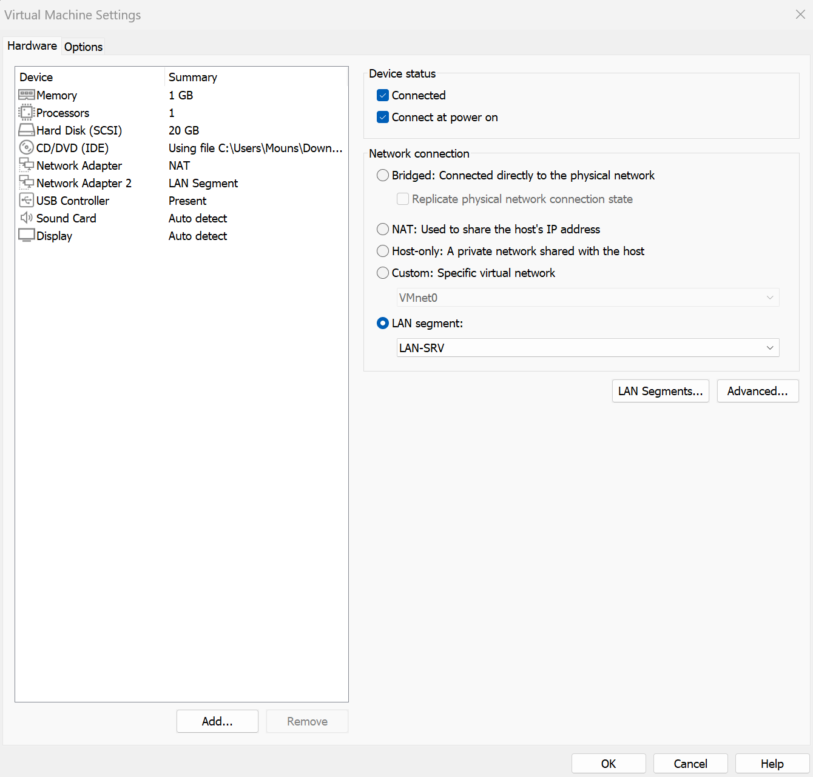

# Module 1 : VMware et les réseaux virtuels

## L'idée

Avant d'installer quoi que ce soit, il faut décider comment les machines sont reliées. Dans une entreprise, ce serait des switchs et des VLAN. Dans mon labo, ce sont les réseaux virtuels de VMware.

## Ce que j'ai fait

1. Installé VMware Workstation Pro, et passé l'interface en anglais pour avoir les mêmes noms de menus que dans la doc officielle.
2. Écrit le plan d'adressage avant de créer la moindre VM (il est dans le [README](../README.md)).
3. Créé deux segments LAN, `LAN-SRV` pour les serveurs et `LAN-POSTES` pour les postes, qui servira en semaine 3.

## Les deux types de réseaux utilisés

| Type | Ce que c'est | Dans le labo |
| --- | --- | --- |
| NAT | La VM sort sur internet en passant par mon PC | La patte WAN de FW01 |
| LAN segment | Un câble privé entre des VM, sans internet et sans mon PC | LAN-SRV et LAN-POSTES |

Seul FW01 est branché sur le NAT. Toutes les autres VM sont uniquement sur des segments, donc pour sortir elles sont obligées de passer par le pare-feu. C'est exactement l'architecture d'une PME : une seule porte vers l'extérieur.

Chaque segment joue le rôle d'un VLAN. En entreprise, on aurait de vrais VLAN sur les switchs et le pare-feu ferait le routage entre eux.

## Capture

## À retenir

Le plan d'adressage s'écrit avant d'installer, et il se documente. Les serveurs en adresses fixes basses, les postes en DHCP à partir de .100, pour qu'il n'y ait jamais de conflit.
