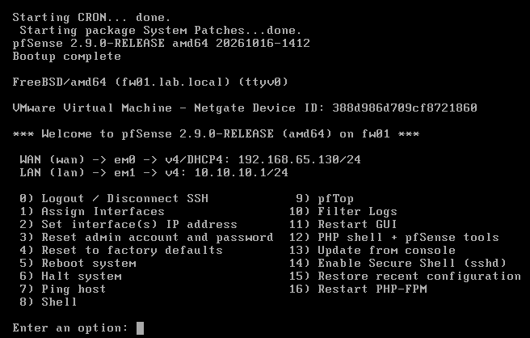

# Module 2 : le pare-feu pfSense

## L'idée

FW01 est la seule porte entre le labo et internet. Tout ce qui sort passe par lui, et il décide de ce qui est autorisé.

## Ce que j'ai fait

1. Créé la VM FW01 (1 Go de RAM, deux cartes réseau : NAT pour le WAN, LAN-SRV pour le LAN).
2. Installé pfSense CE 2.9.0 avec le Netgate Installer.
3. Depuis la console (option 2), donné au LAN l'adresse fixe 10.10.10.1/24, sans activer le DHCP de pfSense, parce que c'est DC01 qui distribuera les adresses.
4. Terminé l'assistant depuis le navigateur de DC01, en HTTPS sur https://10.10.10.1 : nom d'hôte, DNS publics 1.1.1.1 et 9.9.9.9, changement du mot de passe admin.

## Ce que fait le pare-feu tout seul

Il est **stateful** : il se souvient des connexions sorties de l'intérieur et laisse passer leurs réponses, mais refuse tout ce qui arrive de l'extérieur sans avoir été demandé.

Il fait du **NAT sortant** : quand DC01 sort avec 10.10.10.10, pfSense remplace cette adresse par celle de son WAN. Internet ne voit jamais les adresses internes.

Par défaut, tout ce qui vient du LAN peut sortir, tout ce qui arrive sur le WAN est bloqué, et une règle « anti-lockout » m'empêche de me bloquer moi-même l'accès à l'interface web. Je durcirai les règles en semaine 3, quand les postes auront leur propre zone.

## Vérifications

`ping 10.10.10.1` depuis DC01 répond, et l'interface web s'ouvre.

## Captures

