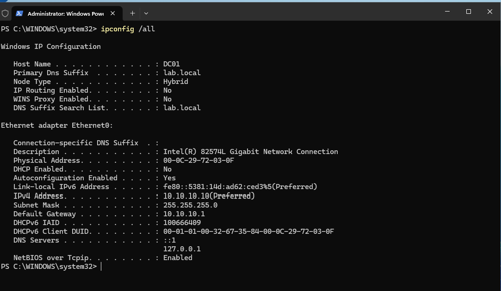
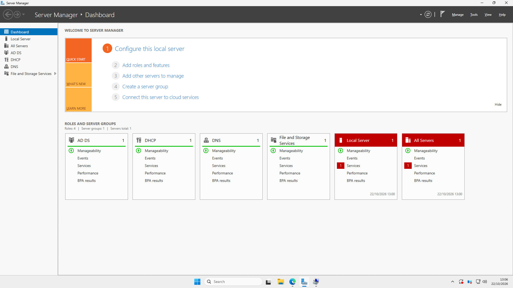
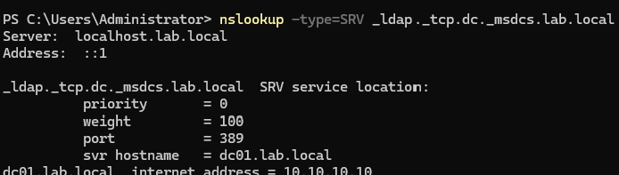
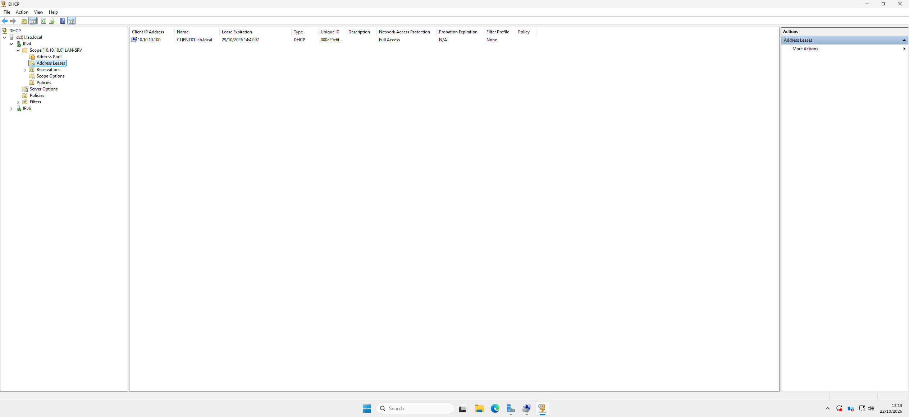
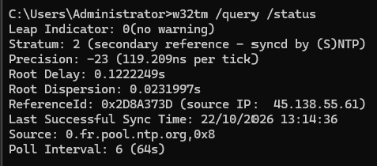

# Module 3 : DC01, le contrôleur de domaine

## L'idée

DC01 est le cœur du SI. Il contient l'annuaire de tous les comptes et de toutes les machines (Active Directory), il répond aux questions de noms (DNS), il distribue les adresses (DHCP) et il donne l'heure au domaine.

## Ce que j'ai fait

1. Installé Windows Server 2025 (version d'évaluation, en anglais).
2. Mis une adresse fixe 10.10.10.10/24, passerelle 10.10.10.1, et renommé le serveur en DC01 **avant** de le promouvoir, parce qu'un contrôleur de domaine se renomme très mal après.
3. Ajouté le rôle AD DS, puis promu le serveur en contrôleur de domaine d'une nouvelle forêt `lab.local` (nom court LAB). Une fois promu, son DNS pointe sur lui-même, 127.0.0.1.
4. DNS : ajouté un redirecteur vers 10.10.10.1. DC01 répond lui-même pour `lab.local`, et transmet le reste (les sites internet) au pare-feu.
5. DHCP : autorisé le serveur dans l'AD, puis créé une étendue de 10.10.10.100 à 10.10.10.200, bail de 8 jours, avec les options routeur 10.10.10.1, DNS 10.10.10.10 et domaine `lab.local`.
6. Heure : fuseau horaire corrigé avec `tzutil`, puis synchronisation sur le pool NTP français avec `w32tm`. DC01 est le maître de l'heure du domaine, tous les PC se calent sur lui.

## Pourquoi le DNS est la pièce maîtresse

Un PC ne connaît pas l'adresse du contrôleur de domaine. Il demande au DNS l'enregistrement SRV `_ldap._tcp.dc._msdcs.lab.local`, et le DNS répond « c'est dc01.lab.local, à l'adresse 10.10.10.10 ». Ces enregistrements ont été créés tout seuls à la promotion. Un PC qui utiliserait 1.1.1.1 comme DNS ne trouverait jamais le domaine, puisque `lab.local` n'existe pas sur internet.

## Vérifications

| Commande | Résultat attendu |
| --- | --- |
| `ipconfig /all` | 10.10.10.10, passerelle 10.10.10.1 |
| `nslookup dc01.lab.local` | 10.10.10.10 |
| `nslookup -type=SRV _ldap._tcp.dc._msdcs.lab.local` | dc01.lab.local, port 389 |
| `w32tm /query /status` | Source : le pool NTP |

## Captures

## À retenir

Kerberos refuse les connexions quand il y a plus de 5 minutes d'écart entre un PC et le contrôleur. L'heure fait partie de la sécurité.
