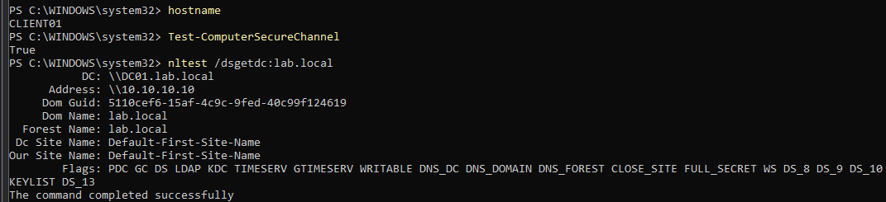
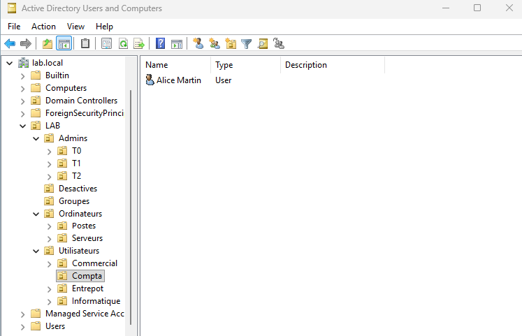
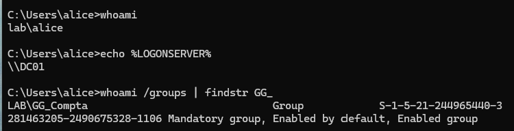
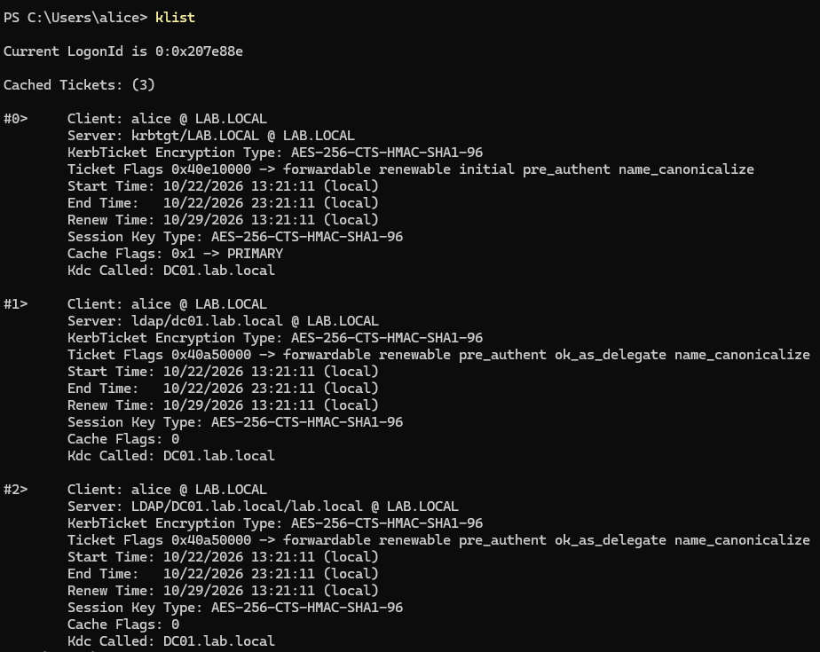

# Module 4 : le poste client et l'annuaire

## Joindre CLIENT01 au domaine

1. Créé la VM Windows 11 avec un TPM virtuel (VMware chiffre uniquement les fichiers nécessaires au TPM), sur le segment LAN-SRV.
2. Installé Windows avec un compte local de secours, `admin-local`, pour pouvoir dépanner le poste si le domaine est injoignable.
3. Laissé la carte réseau en automatique : CLIENT01 a reçu son adresse, sa passerelle et son DNS du DHCP de DC01.
4. Renommé le PC en CLIENT01 et joint le domaine `lab.local` dans la même opération, avec `LAB\Administrator`.

Pendant la jonction, DC01 crée un compte pour la machine elle-même. Le PC et le domaine partagent un secret, changé tout seul tous les 30 jours : c'est le canal sécurisé. Windows ajoute aussi le groupe Domain Admins dans les administrateurs locaux du PC.

Vérification : `Test-ComputerSecureChannel` répond True, et `nltest /dsgetdc:lab.local` trouve DC01.

## Organiser l'annuaire

J'ai rangé l'annuaire selon les règles à appliquer :

```
lab.local
└── LAB
    ├── Admins
    │   ├── T0
    │   ├── T1
    │   └── T2
    ├── Utilisateurs
    │   ├── Compta
    │   ├── Commercial
    │   ├── Entrepot
    │   └── Informatique
    ├── Ordinateurs
    │   ├── Postes
    │   └── Serveurs
    └── Groupes
```

Les personnes et les machines sont séparées parce qu'une GPO vise soit l'un, soit l'autre. Les postes et les serveurs sont séparés parce qu'ils n'ont ni les mêmes règles, ni les mêmes administrateurs. Tout est sous `LAB` pour ne pas se mélanger avec les conteneurs créés par Windows.

Le conteneur `Computers`, où arrivent les nouveaux PC par défaut, n'est pas une OU, on ne peut pas y lier de GPO. J'ai donc lancé `redircmp "OU=Postes,OU=Ordinateurs,OU=LAB,DC=lab,DC=local"` pour que les nouveaux PC arrivent directement dans Postes, et déplacé CLIENT01 à la main.

## Groupes et comptes

Les groupes sont tous de sécurité et d'étendue globale, avec le préfixe GG_ : GG_Compta, GG_Commercial, GG_Entrepot, GG_T1_Admins_Serveurs, GG_T2_Admins_Postes. Les droits sont toujours donnés aux groupes, jamais aux personnes.

| Compte | OU | Groupe | Usage |
| --- | --- | --- | --- |
| msebti | Utilisateurs, Informatique | aucun | Mon compte de tous les jours, sans droit d'admin |
| adm-t2-msebti | Admins, T2 | GG_T2_Admins_Postes | Administrer les postes |
| adm-t1-msebti | Admins, T1 | GG_T1_Admins_Serveurs | Administrer les serveurs |
| adm-t0-msebti | Admins, T0 | Domain Admins | Administrer l'annuaire, seulement sur DC01 |
| alice | Utilisateurs, Compta | GG_Compta | Salariée de la compta |
| bob | Utilisateurs, Commercial | GG_Commercial | Salarié du commercial |

## L'ouverture de session

Quand Alice se connecte, CLIENT01 trouve DC01 grâce au DNS, puis prouve qu'Alice connaît son mot de passe sans jamais l'envoyer sur le réseau (Kerberos). DC01 lui remet un ticket valable environ 10 heures, qui contient son identité et la liste de ses groupes. Elle l'utilise ensuite pour accéder aux partages sans retaper son mot de passe.

Comme la liste des groupes est figée dans le ticket, un utilisateur qu'on ajoute à un groupe doit se déconnecter et se reconnecter pour en profiter.

Vérifications sur CLIENT01, connecté en Alice : `whoami` affiche `lab\alice`, `echo %LOGONSERVER%` affiche `\\DC01`, `whoami /groups` contient `LAB\GG_Compta`, et `klist` montre ses tickets Kerberos.

## Captures








