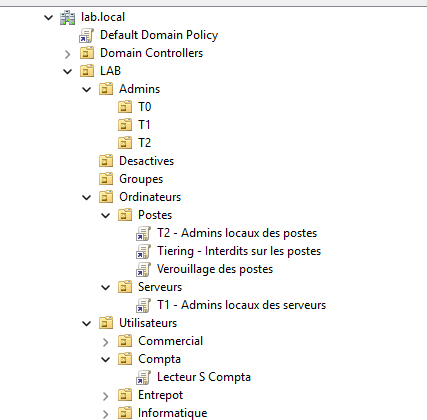
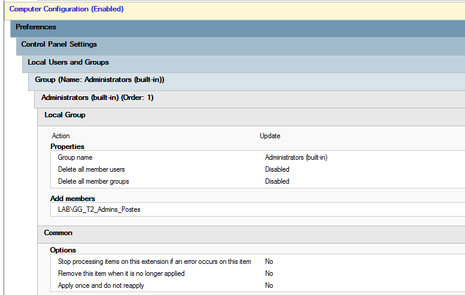
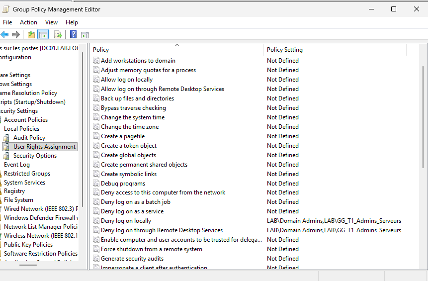
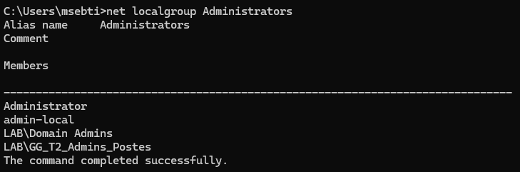
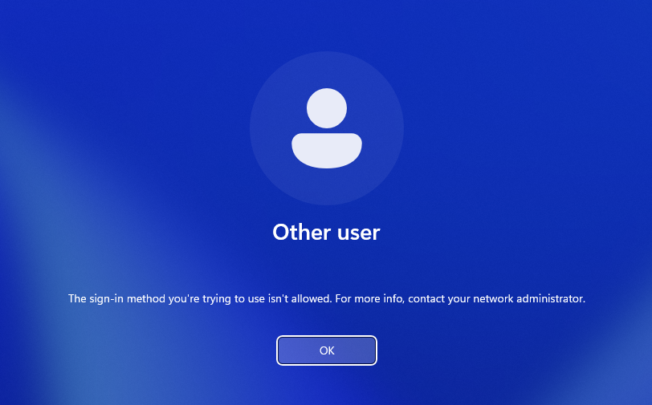
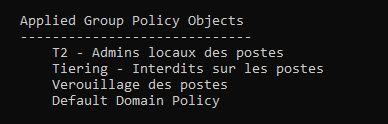
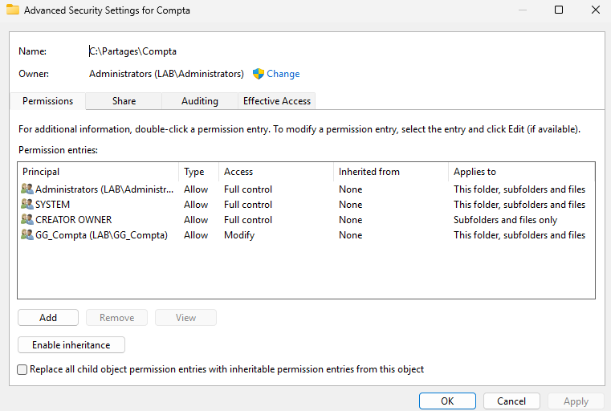
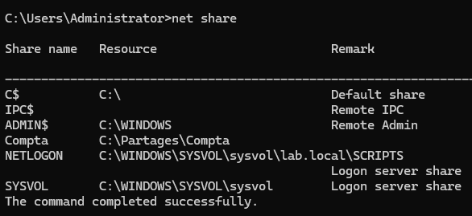
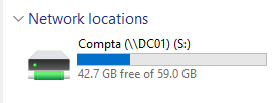
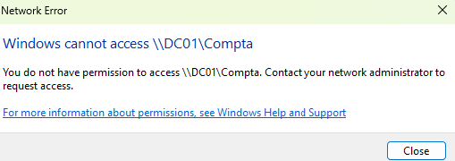

# Module 5 : GPO, tiering et partage de la compta

## Comment marche une GPO

Une GPO, c'est un paquet de réglages qu'on lie à une OU. Elle a deux moitiés :

| Moitié | S'applique à | Quand | Condition |
| --- | --- | --- | --- |
| Computer Configuration | la machine, quel que soit l'utilisateur | au démarrage | l'ordinateur est rangé dans l'OU liée |
| User Configuration | l'utilisateur, sur n'importe quel PC | à l'ouverture de session | le compte est rangé dans l'OU liée |

Une GPO pleine de réglages ordinateur liée à une OU qui ne contient que des utilisateurs ne fait rien, et sans aucun message d'erreur.

Les GPO s'appliquent dans l'ordre local, site, domaine, puis OU de la plus haute à la plus basse (LSDOU). En cas de conflit, la dernière gagne, donc celle de l'OU la plus proche de l'objet.

Dans chaque moitié il y a deux familles. Les **stratégies** (Policies) imposent un réglage que l'utilisateur ne peut pas changer, et il disparaît si on retire la GPO. Les **préférences** (Preferences) posent un réglage comme si on l'avait fait à la main, il est remis à chaque rafraîchissement, et il reste en place si on retire la GPO. Je choisis selon le besoin : verrouiller, c'est une stratégie, ajouter ou brancher quelque chose, c'est une préférence.

## Le tiering en pratique

Trois GPO :

| GPO | Liée à | Type | Ce qu'elle fait |
| --- | --- | --- | --- |
| T2 - Admins locaux des postes | Postes | Préférence (Local Users and Groups) | Ajoute GG_T2_Admins_Postes dans le groupe Administrators (built-in) de chaque poste |
| T1 - Admins locaux des serveurs | Serveurs | Préférence (Local Users and Groups) | Pareil pour GG_T1_Admins_Serveurs sur les serveurs |
| Tiering - Interdits sur les postes | Postes | Stratégie (User Rights Assignment) | Deny log on locally et Deny log on through Remote Desktop Services pour Domain Admins et GG_T1_Admins_Serveurs |

Pour les deux premières, j'ai pris une préférence avec l'action Update plutôt que Restricted Groups, parce que Restricted Groups impose la liste complète et aurait retiré tous les autres administrateurs du PC. Update ajoute le groupe sans toucher au reste.

Le résultat :

| Compte | Sur les postes | Sur les serveurs |
| --- | --- | --- |
| adm-t2-msebti | Admin | Aucun droit |
| adm-t1-msebti | Connexion interdite | Admin |
| adm-t0-msebti | Connexion interdite | Admin |
| msebti, alice, bob | Simple utilisateur | Aucun droit |

L'idée : un compte puissant ne doit jamais se connecter sur un PC de salarié, la zone la plus exposée (mails piégés, clés USB). S'il le faisait, un attaquant déjà présent sur le PC pourrait récupérer sa session.

Vérifications sur CLIENT01, après `gpupdate /force` et un redémarrage : `adm-t0-msebti` et `adm-t1-msebti` sont refusés à la connexion, et `net localgroup Administrators` liste `LAB\GG_T2_Admins_Postes`. `gpresult /r` montre les GPO appliquées.

## Le partage de la compta

1. Créé le dossier `C:\Partages\Compta` sur DC01 (en entreprise, ce serait un serveur de fichiers dédié).
2. **Droits NTFS** : héritage désactivé en convertissant les droits hérités, suppression de la ligne Users (sinon tout le monde pouvait lire), ajout de GG_Compta en Modify. Administrators et SYSTEM gardent le contrôle total.
3. **Partage** : partagé sous le nom `Compta`, avec Full control pour Everyone.
4. **Lecteur réseau** : GPO « Lecteur S Compta », liée à l'OU Compta, User Configuration, Preferences, Drive Maps, action Update, emplacement `\\DC01\Compta`, lettre S.

Par le réseau, il y a deux portes, les droits du partage puis les droits NTFS, et c'est la plus fermée qui gagne. J'ouvre donc complètement le partage et je règle tout dans NTFS : il n'y a qu'un seul endroit à gérer.

Le lecteur est côté utilisateur parce qu'il suit la personne : Alice le retrouve sur n'importe quel PC. Mais ce qui protège vraiment le dossier, ce sont les droits NTFS. Bob ne reçoit pas le lecteur, et s'il tape `\\DC01\Compta` à la main, il a un accès refusé.

## Captures

