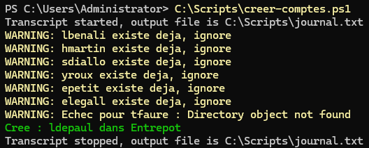

# Module 6 : l'automatisation en PowerShell

## L'idée

Créer deux comptes à la main, ça va. En créer trente à la rentrée, c'est long et plein de fautes de frappe. Le script [creer-comptes.ps1](../scripts/creer-comptes.ps1) lit un fichier CSV et crée chaque compte dans la bonne OU et le bon groupe.

## Le CSV

Une ligne par salarié, colonnes séparées par des points-virgules, enregistré en UTF-8 :

```
Prenom;Nom;Service
Lina;Benali;Entrepot
Hugo;Martin;Commercial
```

La colonne Service doit correspondre exactement au nom de l'OU et au groupe GG_ (sans accent).

## Ce que fait le script

Pour chaque ligne :

1. Il fabrique l'identifiant : première lettre du prénom et nom, sans accents, sans espaces, en minuscules. Élodie Le Gall devient `elegall`.
2. Il vérifie si le compte existe déjà. Si oui, il passe au suivant.
3. Il crée le compte avec `New-ADUser`, dans l'OU du service, avec « changer le mot de passe à la prochaine connexion ».
4. Il l'ajoute au groupe `GG_` du service.
5. Il affiche en vert ce qui a marché, en jaune ce qui a échoué, et continue jusqu'au bout.

Le mot de passe temporaire n'est pas écrit dans le script, il est demandé au lancement.

## Ce que j'ai compris en l'écrivant

**Le splatting.** Au lieu d'écrire `New-ADUser` avec neuf paramètres sur une ligne illisible, je remplis une table `$parametres = @{ ... }`, puis je la passe avec `New-ADUser @parametres`. Le `@` déplie la table en paramètres.

**`$( )` dans les textes.** Entre guillemets, `$login` est remplacé par sa valeur, mais `$s.Service` non, PowerShell s'arrête au point. `$($s.Service)` lui fait calculer toute l'expression avant de l'insérer.

**Idempotent.** Ma première version plantait à la deuxième exécution, parce que les comptes existaient déjà, et elle affichait quand même « compte créé ». La version actuelle peut être relancée autant de fois qu'on veut sans rien casser.

**`try` et `catch` avec `-ErrorAction Stop`.** Si la création d'un compte échoue (OU qui n'existe pas par exemple), le script affiche l'erreur et passe au salarié suivant au lieu de s'arrêter.

## Vérification

```powershell
Get-ADUser -Filter * -SearchBase "OU=Utilisateurs,OU=LAB,DC=lab,DC=local" | Select-Object Name, SamAccountName, Enabled
Get-ADGroupMember GG_Entrepot | Select-Object SamAccountName
```

## Captures



