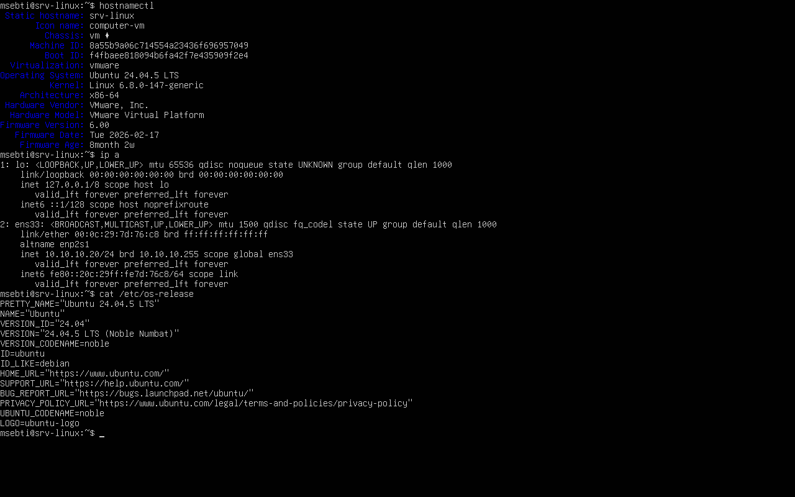
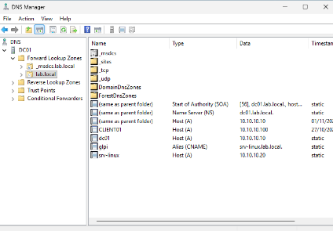
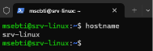

# Module 7 : SRV-LINUX, le serveur Linux

## L'idée

Les outils de la semaine 2, GLPI pour le support et Zabbix pour la supervision, tournent sous Linux, comme la plupart des serveurs web. Il me fallait donc un serveur Linux dans la zone des serveurs, à côté de DC01, et proprement intégré au réseau de l'entreprise.

## L'installation

1. Créé la VM SRV-LINUX : Ubuntu Server 24.04 LTS, 2 processeurs, 4 Go de RAM, 40 Go de disque, carte réseau sur le segment LAN-SRV.
2. Installeur en anglais, clavier français. En anglais, parce que les messages d'erreur se retrouvent mot pour mot sur internet.
3. Réseau en IPv4 manuel : adresse 10.10.10.20/24, passerelle 10.10.10.1, DNS 10.10.10.10 (DC01), domaine de recherche `lab.local`.
4. Disque en LVM, en vérifiant sur l'écran de résumé que le volume système prenait bien tout le disque. Par défaut, l'installeur ne lui en donne qu'une partie.
5. Créé mon utilisateur `msebti` et installé le serveur OpenSSH.

J'ai pris la version LTS plutôt que la plus récente : 5 ans de mises à jour de sécurité, et c'est la version pour laquelle GLPI, Zabbix et Grafana sont testés. Sur un serveur de production, on ne prend jamais la toute dernière version d'un système.

## L'intégration au réseau

1. Sur DC01, dans `dnsmgmt.msc`, ajouté dans la zone `lab.local` un enregistrement A `srv-linux` vers 10.10.10.20, et un alias CNAME `glpi` qui pointe vers `srv-linux.lab.local`. Un serveur Linux qui n'est pas membre du domaine ne s'inscrit pas tout seul dans le DNS, et de toute façon les adresses des serveurs se gèrent à la main.
2. Administré le serveur depuis DC01, en SSH dans PowerShell, comme on le fait avec un serveur rangé dans une baie : `ssh msebti@srv-linux.lab.local`.
3. Mis le système à jour avec `sudo apt update` puis `sudo apt upgrade -y`.
4. Réglé le fuseau horaire sur Europe/Paris avec `timedatectl`, pour que les journaux du serveur se comparent à ceux de Windows.

L'alias `glpi` a un intérêt simple : les salariés retiennent un nom qui dit à quoi il sert, et le jour où GLPI déménage sur un autre serveur, je change une seule ligne dans le DNS.

## Ce que j'ai découvert en route

La configuration réseau est dans un fichier YAML de Netplan, dans `/etc/netplan/`. Une indentation fausse et toute la configuration est ignorée.

`/etc/resolv.conf` affiche `127.0.0.53` et pas l'adresse de DC01. Ce n'est pas une erreur : Ubuntu passe par un petit service local, systemd-resolved, qui transmet les questions au vrai DNS et garde les réponses en cache. Le vrai serveur DNS se voit avec `resolvectl status`.

## Vérifications

| Commande | Résultat attendu |
| --- | --- |
| `hostnamectl` | srv-linux, Ubuntu 24.04 LTS |
| `ip a` | 10.10.10.20/24 sur ens33 |
| `resolvectl status` | DNS 10.10.10.10 |
| `ping -c 3 dc01.lab.local` | DC01 répond |
| `nslookup glpi.lab.local` (sur DC01) | alias de srv-linux.lab.local, 10.10.10.20 |

## Captures

## À retenir

Sur un serveur, on ne travaille jamais en root en permanence. `sudo` donne les droits pour une seule commande, et chaque utilisation est notée dans `/var/log/auth.log`. C'est la même idée que le modèle T0 de la semaine 1.
