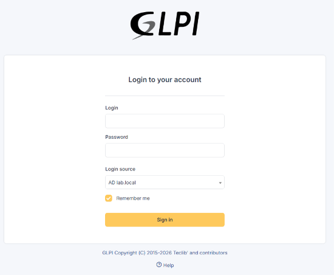
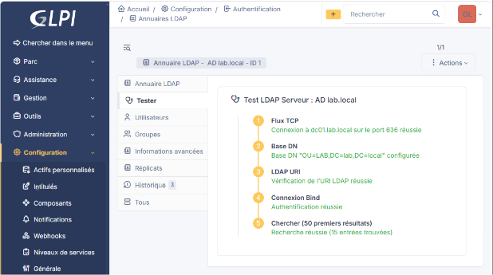
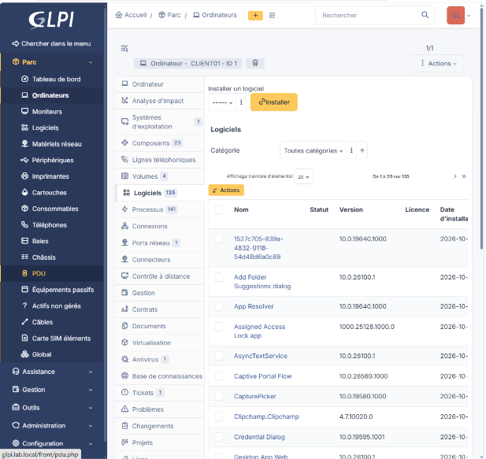
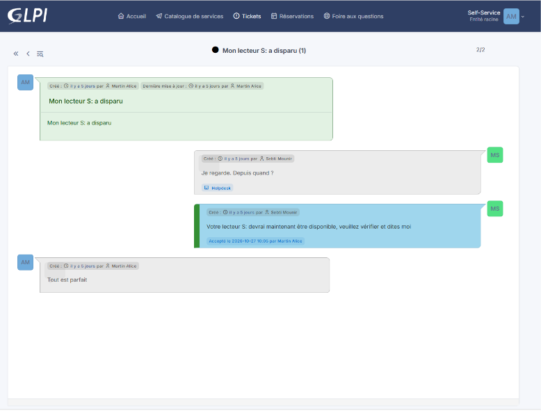

# Module 8 : GLPI, le support et l'inventaire

## L'idée

Chez Calanques Distribution, les salariés appelaient pour tout, rien n'était noté, et personne ne savait exactement quels PC l'entreprise possédait. GLPI règle les deux problèmes : chaque demande devient un ticket suivi, et chaque machine est inventoriée automatiquement.

GLPI est une application web en PHP avec une base MariaDB, servie par Apache : une pile LAMP. C'est le même genre d'application que ce que je faisais en développement avec Symfony, et GLPI 11 est d'ailleurs construit en partie dessus.

## L'installation

1. Installé Apache, MariaDB, PHP et les extensions que GLPI exige (ldap, intl, mbstring, bcmath, gd, curl...).
2. Créé la base `glpi` en utf8mb4, et un utilisateur `glpi` qui ne peut se connecter que depuis le serveur et ne voit que sa base. Si son mot de passe était volé, il ne servirait ni depuis une autre machine, ni pour toucher à la base de Zabbix.
3. Téléchargé la dernière version stable depuis le dépôt officiel `glpi-project/glpi`, décompressée dans `/var/www/glpi`, avec `www-data` comme propriétaire.
4. Créé un site Apache pour `glpi.lab.local` dont la racine est `/var/www/glpi/public`. Seul le dossier `public` est exposé : la configuration, avec le mot de passe de la base, et les documents joints aux tickets restent hors de portée du navigateur.
5. Désactivé le site par défaut d'Apache et vérifié la configuration avec `apache2ctl configtest` avant de recharger. Une faute de frappe dans un fichier, et Apache refuse de redémarrer.
6. Pendant l'assistant, corrigé l'avertissement sur les cookies de session dans `php.ini` : `session.cookie_httponly = On` et `session.cookie_samesite = Lax`.
7. Après l'installation, changé les mots de passe des quatre comptes par défaut (glpi, tech, normal, post-only), connus de tout le monde, et supprimé `install/install.php`, qui permettrait à n'importe qui de relancer l'installation et d'écraser la base.

## La connexion avec les comptes de l'Active Directory

Les salariés ne vont pas retenir un mot de passe de plus. Ils se connectent à GLPI avec leur compte Windows, et un salarié dont je désactive le compte dans l'annuaire perd aussi l'accès à GLPI.

GLPI ne stocke jamais leur mot de passe. Il se connecte à l'annuaire avec son propre compte, cherche celui de la personne, puis demande à DC01 de vérifier le mot de passe tapé.

1. Sur DC01, créé une OU `Services` sous LAB, avec un compte de service `svc-glpi` : mot de passe long, qui n'expire pas, que le compte ne peut pas changer. Il ne sert qu'à lire l'annuaire.
2. Dans GLPI, déclaré l'annuaire `AD lab.local` avec la préconfiguration Active Directory :

| Réglage | Valeur |
| --- | --- |
| Serveur | `ldaps://dc01.lab.local`, port 636 |
| BaseDN | `OU=LAB,DC=lab,DC=local` |
| Compte de connexion | svc-glpi |
| Champ de l'identifiant | samaccountname |
| Filtre | les personnes, sauf les comptes désactivés |

3. Au premier essai en LDAP simple sur le port 389, le test a échoué : Windows Server 2025 refuse par défaut un mot de passe envoyé en clair (le détail est dans le [journal de bord](../journal-de-bord.md)). Je suis donc passé en LDAPS, comme en entreprise.

## Le passage en LDAPS

Pour chiffrer LDAP, le contrôleur de domaine a besoin d'un certificat, signé par une autorité à laquelle GLPI fait confiance. C'est la même mécanique que les sites en HTTPS.

1. Installé sur DC01 le rôle Services de certificats Active Directory, configuré en autorité de certification d'entreprise racine.
2. L'autorité a délivré automatiquement un certificat à DC01 (vérifié dans `certlm.msc`), et j'ai testé le port 636 avec `ldp.exe`.
3. Exporté le certificat de l'autorité, copié sur SRV-LINUX avec `scp`, puis ajouté aux autorités de confiance avec `update-ca-certificates`. `openssl s_client -connect dc01.lab.local:636` confirme que la vérification réussit.
4. Dans GLPI, passé l'annuaire sur `ldaps://dc01.lab.local` et le port 636.
5. Remis la stratégie stricte de signature LDAP, celle de Windows Server 2025 par défaut. La connexion de GLPI marche toujours, parce qu'elle est maintenant chiffrée.

Je me connecte au nom `dc01.lab.local` et pas à l'adresse IP, parce qu'un certificat est délivré à un nom. Par l'adresse, la vérification échouerait.

Le test intégré à GLPI valide les cinq étapes : connexion au port 636, BaseDN, adresse LDAP, authentification du compte de service, et une recherche qui trouve 15 entrées. Alice Martin s'est ensuite connectée avec son mot de passe Windows, et GLPI lui a créé son profil en Self-Service. Je me suis donné le profil Technicien avec mon compte `msebti`.

## L'inventaire automatique

1. Activé l'inventaire dans GLPI (Administration, Inventaire).
2. Installé GLPI Agent sur CLIENT01 avec mon compte admin des postes, `adm-t2-msebti`, et `http://glpi.lab.local/` comme cible.
3. Forcé un premier inventaire depuis la page locale de l'agent, `http://127.0.0.1:62354`.

CLIENT01 est apparu dans Parc, Ordinateurs, avec son système, ses 23 composants, ses volumes et ses 135 logiciels. L'agent interroge Windows par WMI et envoie le résultat à GLPI en HTTP, puis il recommence toutes les 24 heures, donc le parc reste à jour tout seul. En entreprise, on déploierait l'agent sur tous les postes en installation silencieuse, par une GPO.

## Un vrai ticket, de bout en bout

ITIL, la référence des bonnes pratiques de support, distingue deux choses. Un incident, c'est quelque chose qui marchait et qui ne marche plus. Une demande, c'est quelque chose de nouveau, comme un accès ou un logiciel.

1. J'ai créé les catégories Matériel, Logiciel, Réseau, et Comptes et accès.
2. Connectée avec son compte, Alice a ouvert un incident : « Mon lecteur S: a disparu ».
3. Avec mon compte technicien, j'ai pris le ticket, je l'ai associé à CLIENT01, et j'ai ajouté un suivi pour lui demander depuis quand.
4. La cause : son compte avait été déplacé par erreur dans l'OU Commercial, donc la GPO qui monte le lecteur S: de la compta ne s'appliquait plus. Je l'ai remis dans l'OU Compta et j'ai proposé la solution dans le ticket.
5. Alice a vérifié, a accepté la solution et a répondu « Tout est parfait ». Le ticket est clos.

Un ticket, c'est une trace. La demande ne peut plus être oubliée, et je peux prouver ce que j'ai fait et quand.

## Captures

## À retenir

Pendant l'installation, GLPI crée le fichier `config/glpicrypt.key`, qui chiffre les mots de passe qu'il stocke, comme celui de `svc-glpi`. Une sauvegarde de GLPI sans ce fichier rend les tickets, mais plus aucun mot de passe. Il faudra y penser pour les sauvegardes de la semaine 3.
