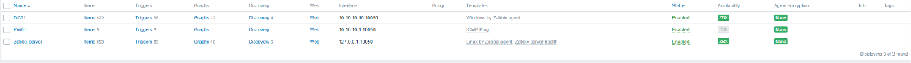
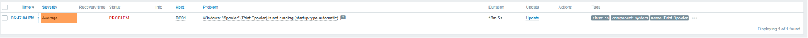
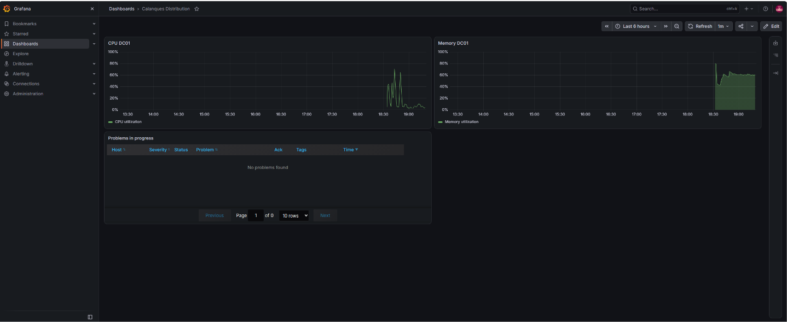

# Module 9 : la supervision avec Zabbix et Grafana

## L'idée

Un vendredi à 17 h, un service plante sur un serveur. Personne ne s'en rend compte, et le lundi matin plus personne ne peut travailler. Un admin ne doit jamais apprendre une panne par un utilisateur : la supervision le prévient avant.

Zabbix, ce sont les capteurs et l'alarme. Un agent installé sur chaque machine fournit ses mesures au serveur Zabbix, qui les compare à des seuils et déclenche une alerte quand quelque chose sort de la normale. Grafana, c'est l'écran de contrôle : il affiche les données de Zabbix sous forme de tableaux de bord.

## Le serveur Zabbix

J'ai installé Zabbix en version LTS (support long, ce que les entreprises installent) sur SRV-LINUX, avec les commandes de la page officielle pour Ubuntu 24.04 :

1. Ajouté le dépôt de Zabbix, puis installé le serveur, l'interface web et l'agent.
2. Créé la base `zabbix` dans MariaDB et son utilisateur, puis importé le schéma initial.
3. Mis le mot de passe de la base dans `/etc/zabbix/zabbix_server.conf`, sur la ligne `DBPassword=`.
4. Démarré et activé les services.
5. Suivi l'assistant sur `http://srv-linux.lab.local/zabbix`, avec le fuseau Europe/Paris, puis changé le mot de passe du compte `Admin` dès la première connexion.

SRV-LINUX se supervise lui-même : c'est l'hôte « Zabbix server », créé par défaut.

## Les hôtes supervisés

| Hôte | Comment | Modèle |
| --- | --- | --- |
| Zabbix server (SRV-LINUX) | agent local | Linux by Zabbix agent, Zabbix server health |
| DC01 | Zabbix agent 2 pour Windows, port 10050 | Windows by Zabbix agent |
| FW01 | ping, sans agent | ICMP Ping |

Sur DC01, j'ai installé Zabbix agent 2 avec 10.10.10.20 comme serveur, et ouvert le port 10050 dans le pare-feu Windows, mais uniquement pour l'adresse de SRV-LINUX. Toutes les minutes environ, le serveur interroge l'agent sur ce port. Le voyant ZBX de DC01 est passé au vert.

Sur un pare-feu, on n'installe pas d'agent : Zabbix vérifie simplement que FW01 répond au ping. C'est pour ça que son voyant ZBX reste gris, il n'y a pas d'agent à joindre.

## Provoquer une vraie alerte

Le modèle Windows découvre tout seul les services qui doivent tourner. Pour tester, j'ai arrêté volontairement le service d'impression sur DC01 :

```powershell
Stop-Service Spooler
```

Dans Surveillance, Problèmes, l'alerte est apparue : `Windows: "Spooler" (Print Spooler) is not running (startup type automatic)`, sur DC01, en gravité Average. Après `Start-Service Spooler`, le problème est passé en résolu.

## Grafana

1. Installé Grafana depuis son dépôt officiel sur SRV-LINUX, accessible sur `http://srv-linux.lab.local:3000`, et changé le mot de passe `admin` par défaut.
2. Installé le plugin Zabbix avec `grafana-cli`, puis activé dans Administration, Plugins.
3. Ajouté une source de données Zabbix qui passe par l'API de Zabbix, `http://localhost/zabbix/api_jsonrpc.php`.
4. Importé les tableaux de bord fournis par le plugin, puis créé le mien, « Calanques Distribution » : le processeur et la mémoire de DC01, et un panneau des problèmes en cours.

C'est le genre d'écran qu'on affiche au mur d'un service informatique : d'un coup d'œil, on voit si tout va bien.

## Captures







## À retenir

Une supervision qu'on n'a jamais vue sonner, on ne sait pas si elle marche. Provoquer soi-même une panne, c'est la seule façon d'en être sûr.
